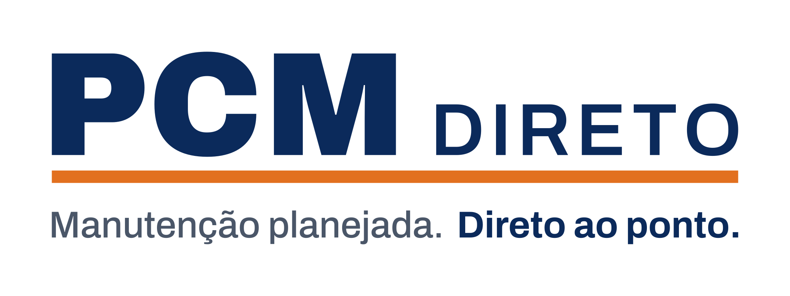

# PCM Direto

Software livre e gratuito para técnicos e pequenas operações de manutenção com até 100 ativos. Encontre um modelo, entenda como usar e organize a rotina. O app funciona no navegador, com os dados da fábrica no aparelho e operação offline após o carregamento completo.

[Portal e modelos](https://pcmdireto.me/) · [Abrir o app](https://pcmdireto.me/app.html#inicio) · [Conhecer o projeto](https://pcmdireto.me/conheca.html) · [Contribuir](CONTRIBUTING.md) · [English](README.en.md)

**Versão de teste.** [Modelos recebidos e limites da integração](docs/ATUALIZACAO-BIBLIOTECA-20261102.md). Modelos R00 em desenvolvimento; validação humana e documental ainda pendente. [Evidências e limites](docs/VALIDACAO-REFORMULACAO.md).

## O que você encontra

- **Biblioteca PCM v2 (pacote 2.0.2):** 19 modelos gratuitos em branco, PCM-MAN-001 a 019, sendo 16 Excel e três Word. Download individual, sem conta. Há também um procedimento já escrito sobre indicadores, separado da contagem dos 19 modelos.
- **Planejamento:** cadastro, colagem, CSV e XLSX; TAGs com validação e sugestões; criticidade por quatro notas de 1 a 5; tarefas, capacidade e revisões com prévia de impacto.
- **Rotina local:** execução por ocorrência, histórico, falhas, fotos, registro de ciência, janelas de parada, etiquetas QR e dashboards. Ciência não é aprovação técnica nem comprovação de identidade.
- **Documentos:** cópias preenchidas dos modelos da Biblioteca v2, por documento, com revisão e data de corte. Alguns recebem conteúdo operacional; outros, apenas cadastros e identificação. O PCM-MAN-011 por ativo e ano é gerado em Mensal.
- **Biblioteca técnica:** 47 tipos e 380 tarefas com origem e versão declaradas como base genérica. Isso não comprova validação com manuais de fabricantes.
- **Meus dados:** backup JSON versão 3 com prévia de restauração, compatível com versões 1 e 2, e lembrete de backup.
- **Comunidade opcional:** modelos de máquinas, curtidas, comentários, denúncias e moderação. A conta online é para contribuir; não sincroniza a operação da fábrica.

## Começar pequeno

1. Abra Comunidade para baixar um modelo ou Meu PCM → Explorar o exemplo. O exemplo fica isolado da base de trabalho.
2. Para usar o app, cadastre poucos equipamentos, confira tarefas, criticidade e capacidade e ative uma revisão.
3. Registre uma execução, consulte a semana e gere o documento necessário. Confira o arquivo no editor antes de usar.
4. Baixe o backup em Meus dados. Limpar o navegador, mudar de origem ou trocar de aparelho exige restaurar uma cópia.

Os dados operacionais ficam no IndexedDB deste navegador. A consulta pública, o login e o conteúdo enviado à Comunidade usam o Supabase, sem sincronizar a base operacional. Não publique TAGs, nomes, registros ou backups reais. O aplicativo não usa analytics nem rastreamento; não há sincronização automática entre aparelhos.

Quando houver atualização, termine o trabalho, feche todas as abas e a janela instalada do PCM Direto e abra novamente. Não é necessário apagar os dados do navegador.

> **Aviso:** O material apoia a organização do PCM e não substitui a avaliação de profissional habilitado nem o texto oficial das normas. Periodicidades são base genérica a validar com manual do fabricante.

## Rodar e contribuir

Use Node.js 24 e Git. No checkout: `npm ci`, depois `npm run dev`. Para conferir: `npm run verificar`. HTML, CSS e JavaScript com Vite, sem framework. [Guia completo](CONTRIBUTING.md) · [Conferência de navegador](docs/TESTES-NAVEGADOR.md).

Você pode testar, melhorar explicações, propor conteúdo com fonte ou contribuir com código. Ferramentas de IA e serviços pagos são opcionais. [Discussões](https://github.com/td9251156-creator/pcm-direto/discussions) · [Relatar erro](https://github.com/td9251156-creator/pcm-direto/issues/new?template=1-relatar-erro.yml) · [Segurança](SECURITY.md).

## Situação e próximos passos

Entrada por necessidade, contribuição e questionário local já integram o projeto. O portal público reúne os 19 modelos, orientação de uso e o primeiro guia aprofundado de OS; o link do material continua no app sem alterar dados automaticamente.

As conversas por material estão ativas com revisão prévia. O mantenedor confirmou login, envio e aprovação; uma conferência sem login confirmou a leitura da mensagem aprovada. Retirada e autorização entre duas contas reais ainda aguardam conferência.

Faltam medidas confirmadas de uso e retorno; estrelas e forks não substituem essas medidas.

[Índice dos documentos](docs/README.md) · [Roadmap](ROADMAP.md) · [Governança](docs/GOVERNANCA.md) · [Preparação open source](docs/PREPARACAO-OPEN-SOURCE.md) · [Créditos e licenças de terceiros](CREDITOS.md).

Código e biblioteca técnica sob [MIT](LICENSE). O software e a biblioteca pública continuam gratuitos; eventual patrocínio, implantação ou produto comercial separado não condiciona o acesso nem retira materiais abertos. Nenhum pagamento, patrocínio ou resultado financeiro é prometido.

Criado e mantido por **Thiago Oliveira Lima**. Copyright (c) 2026. Contato: **pcmdireto@gmail.com**. Parte do código foi escrita com ajuda de IA e revisada pelo autor; consulte os créditos.
