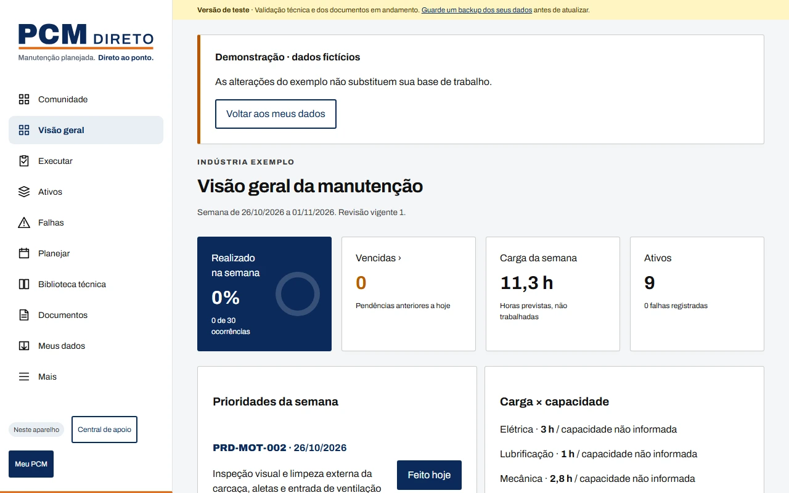
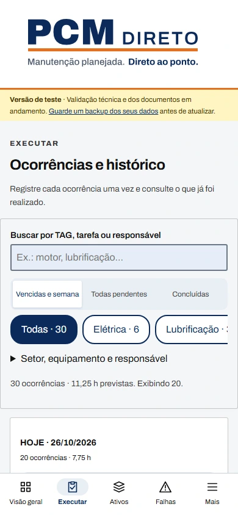
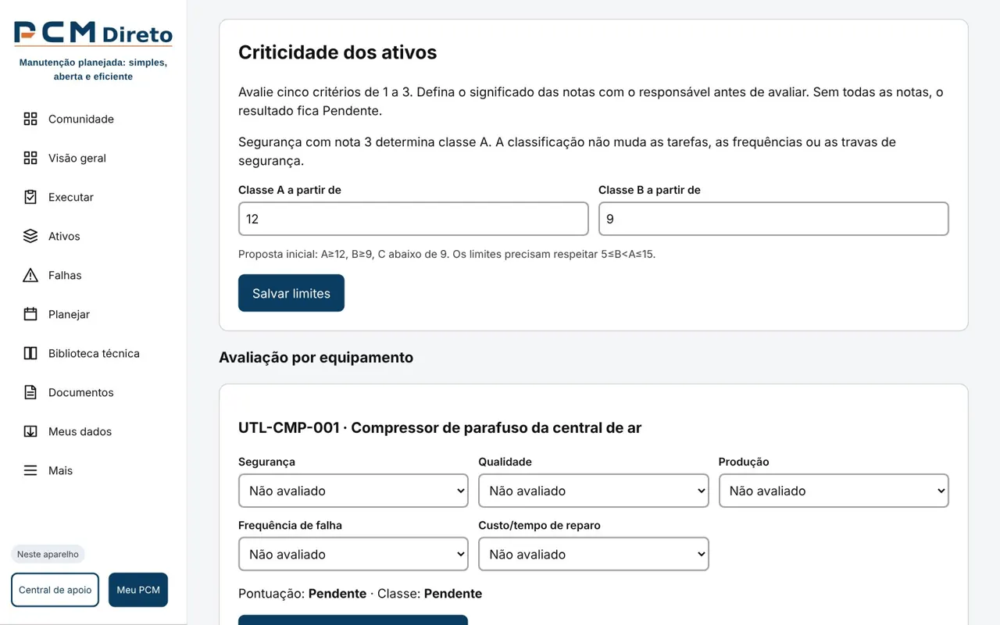
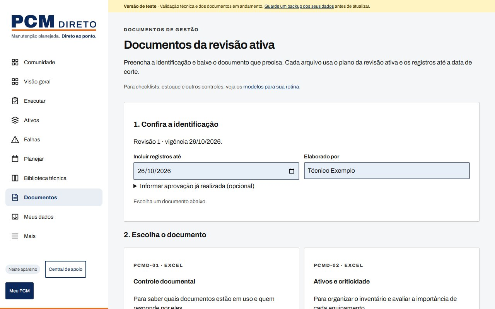

<p align="center"></p>

<h1 align="center">PCM Direto</h1>

<p align="center"><strong>Manutenção planejada. Direto ao ponto.</strong></p>

<p align="center">
  <a href="https://pcmdireto.me/"><strong>Abrir o app</strong></a> ·
  <a href="https://pcmdireto.me/conheca.html">Conheça o projeto</a> ·
  <a href="https://pcmdireto.me/#comunidade">Modelos PCMD gratuitos</a> ·
  <a href="#como-contribuir">Como contribuir</a>
</p>

<p align="center">
  <a href="LICENSE"></a>
  
  
  
</p>

O PCM Direto monta o plano de manutenção preventiva da sua fábrica a partir da lista de máquinas,
de graça, em português e com os dados guardados só no seu aparelho. Para fábricas com até 100 ativos.

<p align="center"></p>

| Executar no celular | Criticidade A/B/C | Documentos PCMD |
|---|---|---|
|  |  |  |

## O que o app faz

Ferramenta aberta de Planejamento e Controle de Manutenção, em português, para uma fábrica com até 100 ativos. Interface Gestão, com comunidade na abertura e tema claro.

- **Comunidade:** modelos PCMD, exemplos e biblioteca técnica para download; catálogo online com publicações, curtidas, comentários, denúncias e moderação no Supabase.
- **Máquinas e tarefas:** fichas PDF da biblioteca para baixar offline. Na comunidade, é possível anexar PDF pronto de até 5 MB e 200 páginas; fica privado até a aprovação do modelo. JSON continua em Outros formatos.
- **Gerar minha ficha:** no formulário do catálogo ou em um tipo da Biblioteca técnica, use Gerar ficha em PDF. A prévia abre em outra aba; escolha Imprimir / salvar PDF e selecione Salvar como PDF. A geração funciona localmente e não envia os campos ao servidor.
- **Fábrica privada:** cadastros, planos, criticidade, execuções e falhas ficam no IndexedDB deste navegador, sem sincronização da base operacional.
- **Planejar:** equipamentos por cadastro, colagem, CSV ou XLSX, criticidade com cinco notas, capacidade e revisões com vigência. A prévia compara tarefas, responsáveis, capacidade semanal e carga afetada por especialidade; editar os campos ou mudar o plano exige nova conferência antes de ativar.
- **Executar:** busca por TAG, tarefa ou responsável, datas legíveis e conclusões mais recentes primeiro. Histórico com filtros por data realizada e situação, páginas e download da consulta. Cancelar exige confirmação e mantém o registro anterior se a gravação falhar. Execuções antigas permanecem como legado sem vínculo presumido.
- **Documentos:** modelos de gestão 2.0.1-marca, com o logo oficial atualizado em 26/10/2026, com os seis modelos e seus exemplos. Cópias preenchidas usam uma data de corte comum; exportações anteriores em Outros formatos. As 12 prévias PDF do Banco de modelos são arquivos estáticos fornecidos, sem dados da fábrica.
- **Meus dados:** backup JSON versão 3 e restauração com prévia; aceita versões 1 e 2 e preserva os originais locais na migração.
- PWA para computador e celular; operação local e documentos offline após carregamento. Comunidade entre aparelhos exige internet.
- Licença MIT. HTML, CSS, JavaScript e Vite, sem framework.

> **Aviso:** O material apoia a organização do PCM e não substitui a avaliação de profissional habilitado nem o texto oficial das normas. Periodicidades são base genérica a validar com manual do fabricante.

## Como usar

1. Abra Comunidade para baixar modelos ou Mais → Primeiros passos → Começar meu PCM. O exemplo fica isolado dos dados de trabalho.
2. Cadastre organização, setores e equipamentos; avalie a criticidade e atribua responsáveis quando disponíveis.
3. Em Planejar, confira tarefas e capacidade; informe elaborador, vigência e resumo e confira o impacto antes de ativar a revisão.
4. Em Executar, selecione a ocorrência e use Feito hoje ou informe os detalhes. Registre falhas em Mais → Falhas.
5. Em Documentos, confira a identificação, escolha um documento e abra o arquivo no editor antes da aprovação.
6. Baixe backups em Mais → Meus dados. Limpar o navegador, mudar a origem ou trocar de aparelho exige restauração de backup.

Quando aparecer **Uma atualização está pronta**, termine seu trabalho e feche todas as abas
do PCM Direto, incluindo a janela do aplicativo instalado. Abra novamente para usar a versão
nova. A atualização não recarrega formulários em uso e não exige limpar os dados do navegador.

Não publique TAGs, nomes ou registros privados na comunidade. A configuração de produção contém somente chave pública publishable/anon; nunca use chave secret/service_role no navegador.

Reformulação em validação: veja [decisões atuais](docs/REFORMULACAO.md) e [evidências e limites](docs/VALIDACAO-REFORMULACAO.md). O plano completo depende de validação humana e documental.

### Formato para colar do Excel ou importar CSV

Colunas, nesta ordem, com ou sem linha de cabeçalho:

```
setor;tipo;descricao;fabricante;modelo
UTL;compressor_ar;Compressor da linha de ar;Fabricante Exemplo;CX-100
```

Tipos aceitos na biblioteca: `motor_eletrico`, `compressor_ar`, `bomba_centrifuga`, `ponte_rolante`,
`transportador_correia`, `ventilador_exaustor` e `unidade_hidraulica`.
O separador pode ser ponto e vírgula, vírgula ou tabulação (o padrão ao copiar do Excel).

## Interface de gestão

- **Cadastros:** organização/setores, pessoas/funções, consulta das frequências e tipos, metas e requisitos.
- **Criticidade:** cinco notas por ativo, limites A/B editáveis, sem alterar tarefas de segurança.
- **Plano Mestre:** tarefas ativas e responsáveis, com busca e próximas ocorrências do cronograma atual.
- **Mensal:** janeiro a dezembro do ano consultado; horas, previsto e realizado com vínculo explícito.
- **Falhas:** registro e correção de sintoma, causa provável, ação, parada e responsável.

Pessoas podem ser editadas e inativadas. Preencha e salve cada formulário; os rascunhos dos demais
formulários de Cadastros são preservados ao salvar outro cadastro na mesma tela. Remover um ativo
não apaga os registros anteriores: eles ficam identificados como fora da lista atual.
Metas não definidas permanecem vazias. Consulte MTBF, MTTR e disponibilidade em Mensal, por ativo
e mês fechado, com horas planejadas sem paradas programadas, parada total conferida e registros
de falhas e reparos. Conclusão e duração do reparo são informadas em Falhas; dados ausentes não
viram zero. Referências começam não verificadas; nenhuma conformidade é certificada.

Os seis modelos Excel e Word recebidos estão em `public/modelos`. Documentos preenche cópias
com os dados da revisão; a conferência no Excel/LibreOffice continua pendente. Exportações
anteriores ficam em Outros formatos. Para guardar toda a base, use o backup completo em Meus dados;
o download filtrado do histórico serve apenas para consulta.

## Como rodar no seu computador

Pré-requisito: [Node.js LTS](https://nodejs.org/) instalado.

```bash
npm install
npm run dev
```

Abra o endereço que aparecer no terminal (normalmente http://localhost:5173).

Outros comandos:

| Comando           | O que faz                                          |
|-------------------|----------------------------------------------------|
| `npm test`        | Roda os testes automáticos                         |
| `npm run lint`    | Verifica o código                                  |
| `npm run build`   | Gera a versão final na pasta `dist/`               |
| `npm run preview` | Abre a versão final localmente                     |

## Logo e ícones

A assinatura completa do cabeçalho é o SVG oficial `public/marca/logo/PCM-Direto_horizontal-slogan_cor.svg`, com proporção e slogan preservados. As cores ficam em `src/marca.js`, e Archivo e IBM Plex Mono são servidas localmente. Os ícones do aplicativo ficam em `public/icones`.

O manual da marca, o Design System e os modelos-base são referências de trabalho do mantenedor, fora da distribuição do site. Mudanças de identidade devem preservar o logo oficial nos modelos, exemplos, prévias e arquivos gerados; os testes conferem hashes e conteúdo funcional.

## Como contribuir

Não é preciso saber programar. Quem trabalha com manutenção já pode ajudar muito:

- **Testar e contar o que achou:** abra o app, explore o exemplo e escreva para pcmdireto@gmail.com
  ou [abra uma sugestão](https://github.com/td9251156-creator/pcm-direto/issues/new/choose).
- **Sugerir uma tarefa ou máquina para a biblioteca:** use o formulário "Sugerir tarefa de manutenção",
  sempre informando a origem (manual do fabricante, experiência ou norma com versão e data).
- **Sugerir um artigo para a Central de apoio:** use o formulário "Sugerir artigo".
- **Relatar um erro:** use o formulário "Relatar um erro", com passos para repetir e dados fictícios.
- **Compartilhar modelos:** publique modelos técnicos na comunidade do app, sem TAGs ou dados da sua fábrica.
- **Conversar com a comunidade:** tire dúvidas e troque experiências nas [Discussões](https://github.com/td9251156-creator/pcm-direto/discussions).
- **Código:** veja [CONTRIBUTING.md](CONTRIBUTING.md).

Quem contribui entra nos [créditos](CREDITOS.md).

## Biblioteca técnica

As tarefas de manutenção ficam em um único arquivo: [`src/dados/biblioteca.json`](src/dados/biblioteca.json).
Veja [BIBLIOTECA.md](BIBLIOTECA.md) para entender o formato e o checklist de revisão.

## Documentos do projeto

[ROADMAP.md](ROADMAP.md) · [DECISOES.md](DECISOES.md) · [CONTRIBUTING.md](CONTRIBUTING.md) ·
[CODE_OF_CONDUCT.md](CODE_OF_CONDUCT.md) · [SECURITY.md](SECURITY.md) · [CREDITOS.md](CREDITOS.md) · [LICENSE](LICENSE)

[Lista priorizada de melhorias](docs/MELHORIAS.md), com problemas encontrados e próximas rodadas.
[Histórico das revisões e melhorias](docs/REVISOES.md).

[Estratégia de evolução com agentes](docs/EVOLUCAO-CONTINUA.md) · [Fila de trabalho atual](docs/FILA.md).

## Sobre o autor

**Thiago Oliveira Lima** — Engenheiro de Produção com mais de 10 anos em manutenção industrial no setor automotivo,
com experiência em PCM, análise de falhas (8D, MASP, FMEA), auditorias ISO e indicadores de manutenção.
[linkedin.com/in/thiagooliveiralima94](https://linkedin.com/in/thiagooliveiralima94)

Parte do código deste projeto foi escrita com ajuda de IA e revisada pelo autor.

## Licença

[MIT](LICENSE) — Copyright (c) 2026 Thiago Oliveira Lima.


## Manual final e modelos adicionais

A identidade visual segue o manual final de outubro de 2026: azul PCM, laranja como sinal, Archivo e IBM Plex Mono locais. O manual, o Design System e os modelos-base da identidade são referências internas do mantenedor e não fazem parte do site.

**Modelos para sua rotina** reúne 18 documentos por finalidade, com explicação de uso, orientação inicial, busca, filtro e prévia PDF. Cada download entrega um único Excel ou Word. **Preencher um modelo** insere os dados disponíveis dos equipamentos em edição em cinco modelos; os outros 13 são manuais e dispensam cadastro. O formulário permanece na memória ao navegar, até recarregar a página. Não há download de todos juntos.

**Documentos** continua emitindo os seis modelos da revisão ativa, com data de corte, aprovação explícita, execuções e falhas. Os novos arquivos ficam separados em public/modelos/refeitos para preservar os contratos e exemplos já existentes. Os documentos do rascunho não substituem a emissão da revisão ativa.


## Uso diário e configuração

Em **Mais**, os acessos ficam organizados por Rotina, Planejamento, Documentos e Dados e apoio. A busca aceita termos como backup, plano ou modelos. Os documentos da revisão ativa, os modelos em branco e o preenchimento com equipamentos em edição têm acessos com finalidades explícitas.

O assistente confirma uma etapa após guardar os dados. Durante a gravação, os controles ficam bloqueados para impedir repetições; sair da tela não provoca retorno automático. Se a gravação falhar, a etapa e os campos são preservados e o aplicativo orienta guardar um backup. O formulário de organização aceita Enter e mantém o rascunho ao navegar durante a sessão. Recarregar descarta campos ainda não confirmados.

O plano atual de continuidade e as validações ainda necessárias estão em [Plano de desenvolvimento](docs/PLANO-DESENVOLVIMENTO.md).
